# 루드라의 비보 — 슈퍼 패미컴 한글패치

일본판 **ルドラの秘宝(루드라의 비보)**(슈퍼 패미컴, 1996, 스퀘어)의 비공식 한글패치 **v2.0.0 (2026-11-16)** 입니다. 외부 기계 번역 없이 직접 번역했습니다.

[정식 패치 다운로드](https://github.com/snake759494/rudra-no-hihou-sfc-korean-patch/releases/latest) · [빌드](docs/BUILD.md) · [기술 설명](docs/TECHNICAL.md) · [검증 범위](docs/VALIDATION.md) · [한글 언령 목록](docs/MANTRA.md) · [변경 이력](CHANGELOG.md) · [권리 안내](RIGHTS.md)

## 게임 소개

『루드라의 비보』는 스퀘어가 1996년 4월 슈퍼 패미컴으로 낸 RPG입니다. 4천 년마다 되풀이되는 멸망의 날까지 남은 15일 동안, 시온·사렌트·리자(그리고 이야기가 진행되면 듄) 네 주인공의 시나리오를 오가며 세계의 운명을 풀어 갑니다. 마법이 정해져 있지 않고 플레이어가 직접 단어를 입력해 주문을 만드는 **언령(言霊) 시스템**으로 유명합니다.

## 적용 방법

1. 직접 준비한 원본 일본판 ROM(4MB, 헤더 없음)의 SHA-256이 아래 `source`와 일치하는지 확인합니다.
2. 릴리즈에서 **Rudra_no_Hihou_SFC_KR.xdelta** 하나를 받습니다.
3. xdelta UI 또는 아래 명령으로 원본에 적용합니다.
4. 결과 ROM의 SHA-256을 확인한 뒤 새로 부팅합니다. 원본이나 이전 패치에서 만든 세이브 스테이트는 쓰지 마세요.

> **v1.x 세이브 주의**: v2.0은 글자 코드를 새로 배정했기 때문에 v1.x(및 일본판)에서 만든 SRAM 세이브를 불러오면 캐릭터 이름과 만들어 둔 언령이 다른 글자로 보이고 다른 주문으로 판정됩니다. **새로 시작하는 것을 권장합니다.**

```powershell
.\xdelta.exe -d -s 'Rudra no Hihou (Japan).sfc' 'Rudra_no_Hihou_SFC_KR.xdelta' 'Rudra no Hihou (Korean).sfc'
Get-FileHash -Algorithm SHA256 'Rudra no Hihou (Korean).sfc'
```

원본·패치·결과 해시를 한 번에 확인하려면 저장소의 `tools/apply_release.py`를 사용할 수 있습니다.

| 구분 | 바이트 | SHA-256 |
| --- | ---: | --- |
| source | 4,194,304 | `34552e3a1ecad8a6e979432226a49bd810c2f3c7ea3280e5dbb91e4db868a728` |
| output | 4,194,304 | `fcc3bae29d287a8ed368e749a4c57eb64668f64b20a6fc595f94991f4d1f288b` |
| patch | 195,901 | `ac3c81bd6fe010e84857606840d770a107e04d0894159adfcb9b7ac19ab42868` |

xdelta는 압축 옵션 없이 **`-e -0`**으로 빠르게 생성했습니다. 릴리즈 첨부는 xdelta 하나이며 ROM·글꼴·외부 실행 파일·저장 파일은 포함하지 않습니다.

## 한글화 내용

- **대사 전체**: 네 주인공 시나리오의 이벤트 대사·선택지·안내문 **4,718개**.
- **시스템 문장 392개**: 아이템·장비·언령 설명, 상점·여관·세이브 메시지, 시나리오 선택·캐릭터 소개, 전투 대사.
- **이름 데이터**: 아이템·장비 256개, 몬스터 256개, 지명·인물·기술·명령 등 약 620개.
- **메뉴 그림 글자 98곳**: 메인 메뉴, 장비·스테이터스·모드·저장 화면 라벨 등.
- **오프닝 프롤로그** 21줄(그림 글자), 사렌트 도입·예언서·엔딩 자막.
- **속성 아이콘**(불·물·뇌·풍·양·음), 시나리오 선택 화면의 「여행 ○일」 표시.
- **한글 언령 시스템**: 언령 사전 2,048칸을 한글 음절 표기로 다시 만들고 이름·언령 입력판을 한글 96칸(11열×9행)으로 바꿨습니다. 입력판에서 「샤나」, 「이그나」처럼 한글로 쓰면 원판의 シャナ·イグナ와 똑같이 판정됩니다. 대사·보물상자 힌트, 캐릭터 초기 언령, 적 언령 이름도 같은 표기로 맞췄습니다. 전체 목록은 [한글 언령 목록](docs/MANTRA.md)에 있습니다.
- **타이틀 화면**: 원본 로고 아래에 「루드라의 비보」 한글 자막을 스프라이트로 추가.
- 글꼴: 대사 **갈무리11 Bold**(12px, 늘리거나 줄이지 않은 원래 크기), 메뉴 **갈무리7**(가로 2배 하이레스 = 화면상 원래 크기), 한글 약 890자.

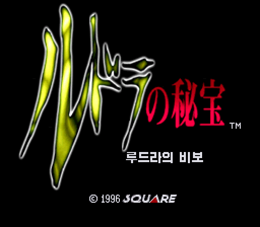 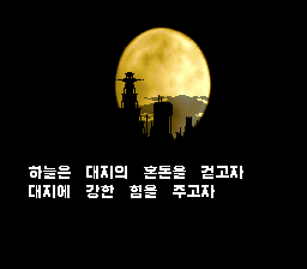
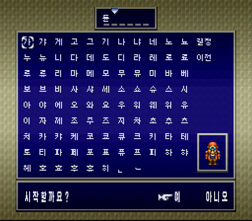 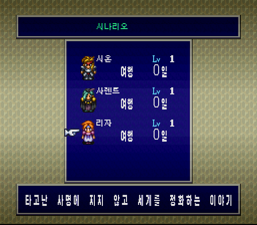
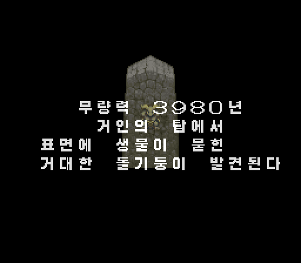 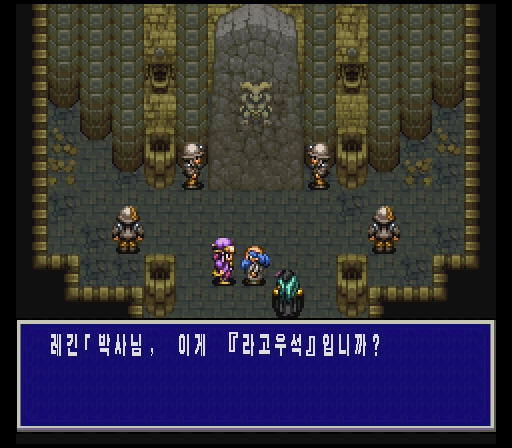
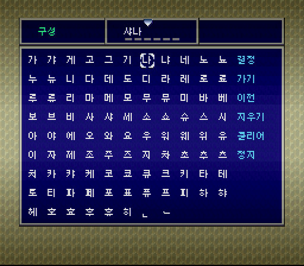 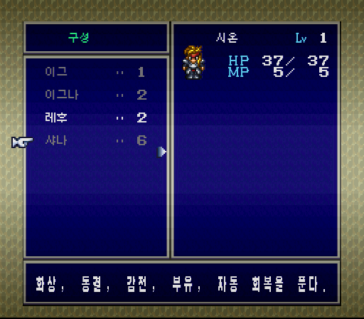
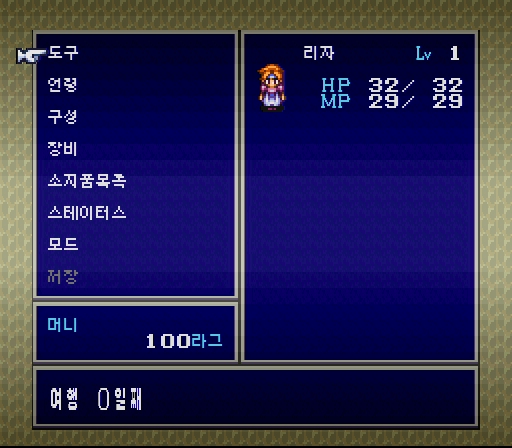 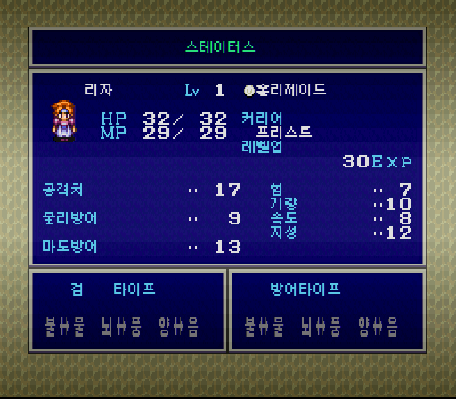
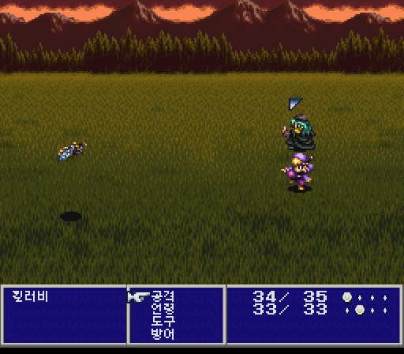 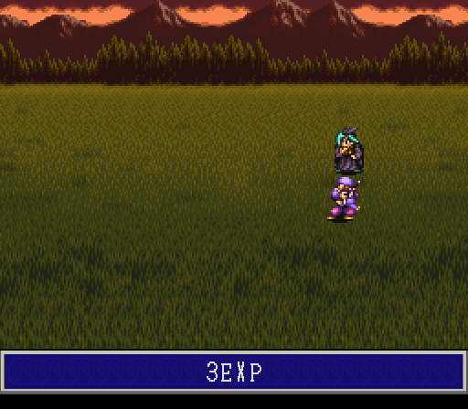

## 원문·영문으로 남은 부분

- 타이틀 로고 「ルドラの秘宝」, 저작권 표기, `HP`·`MP`·`EXP`·`Lv`·`MISS` 등 약어.
- 언령은 뜻을 번역하지 않고 원래 주문을 한글로 소리 나는 대로 적었습니다(イグ→이그, レフ→레후). 입력판 칸 수와 1바이트 글자 수 제한 때문에 ン은 「ㄴ」 한 칸(앞 음절 받침처럼 보이게 그림), ッ는 생략, 드문 음절 5개는 풀어 씁니다(ギョ→기요 등). 작은 글자 하나나 ッ만으로 된 단어 30개(ッ, ァ, アッ 등)는 한글로 구분할 수 없어 입력할 수 없습니다.
- 메뉴 글꼴은 1바이트 코드 칸이 124개뿐이라, 메뉴에 나오는 일부 이름은 쓸 수 있는 음절로 맞췄습니다(예: 몬스터 「퓨처」→「프치어」, 스테이터스 「직업」 대신 「커리어」).

## 검증 범위

헤드리스 snes9x(libretro)로 실행해 **사전 단어 1,918개 전체와 조합·무작위 단어를 일본판과 한글판에 각각 입력해 판정 결과(WRAM 구조체)가 같은지 비교**했고, 입력판으로 「샤나」를 직접 입력해 목록 등록과 효과 설명을 확인했습니다. v1.0에서는 타이틀, 프롤로그, 이름 입력, 시나리오 선택, 시온·사렌트·리자 시나리오 도입부, 메뉴 전체(도구·언령·구성·장비·소지품·스테이터스·모드), 여관 숙박과 저장, 필드 전투와 결과 화면을 확인했습니다. 공개 도구로 재빌드한 결과가 릴리즈 ROM과 바이트 단위로 같음을 확인했습니다. 검증용 에뮬레이터는 종료했습니다.

**중반 이후 시나리오, 상점 화면, 엔딩의 실제 화면, 실기 검증은 미실시입니다.** 자세한 내용은 [검증 문서](docs/VALIDATION.md)를 확인하세요.

## 공개 자료

`translation/`에 직접 번역한 한국어 문장을, `tools/`에 빌드 도구(파이썬, 65816 훅 코드 포함)를, `data/`에 문자열 주소·포인터 위치 같은 구조 정보만 공개합니다. 일본어 원문은 포함하지 않으며 빌드 시 사용자 ROM에서 읽습니다. 재빌드에는 사용자가 준비한 원본 ROM과 해시가 맞는 공식 글꼴이 필요합니다. 이 저장소는 원작이나 글꼴의 권리를 부여하지 않습니다.

문제 제보에는 원본·결과 ROM 해시, 발생 위치, 재현 순서와 화면 캡처를 첨부해 주세요. ROM 파일과 저장 파일은 공개 이슈에 올리지 마세요.
